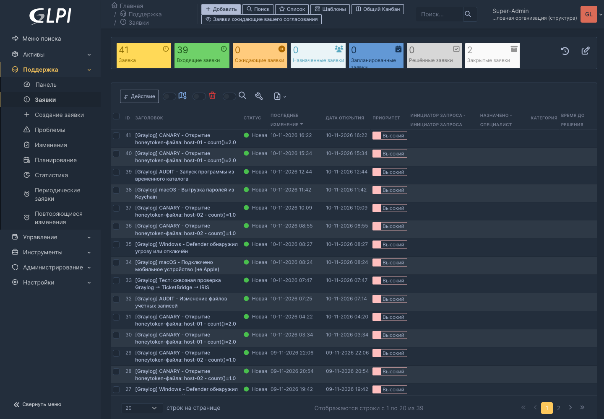

# TicketBridge

Мост «Graylog → GLPI + DFIR-IRIS» маршрутизирует алерты по приоритету:
High создаёт заявку GLPI со ссылками на разбор в HomeWiki, отчёт TrafficLens
и кнопкой блокировки IOC в BlockBoard, а также алерт в IRIS; Medium и Low
создают только алерт IRIS и не перегружают GLPI. Действия логируются обратно
в Graylog (GELF). Поддерживаются IRIS v2 (`POST /alerts/add`) и v3
(`POST /api/v2/alerts`), включая разные форматы ответа. Для передачи в IRIS
нужны `TB_IRIS_URL` и `TB_IRIS_KEY`; без них мост продолжает обрабатывать GLPI.

```
Graylog (HTTP notification) --POST /hook?key=...--> TicketBridge --REST--> GLPI Ticket
                                                             \--REST--> DFIR-IRIS Alert
```

## Скриншоты



## Корреляция инцидентов

Повторный алерт того же хоста (ключ: `fields.host` / `source` /
`event.key`) в течение окна `TB_CORR_WINDOW` (по умолчанию 1800 с)
не создаёт новый тикет, а дописывается **followup**'ом в уже открытый
— один инцидент вместо серии дублей. Закрытый тикет или истёкшее окно —
новый тикет. Состояние — в SQLite `state.db` рядом с приложением.

## Установка (сервер)

```bash
mkdir -p ~/ticketbridge && cp app.py iris_evidence_pack.py velociraptor_evidence.py ~/ticketbridge/
cp ticketbridge.env ~/ticketbridge/   # заполнить токены GLPI
cp systemd/ticketbridge.service ~/.config/systemd/user/
systemctl --user daemon-reload && systemctl --user enable --now ticketbridge
```

## Настройка DFIR-IRIS

- IRIS v2.4.x: `TB_IRIS_API_PATH=/alerts/add` (значение по умолчанию в коде).
- IRIS v3: `TB_IRIS_API_PATH=/api/v2/alerts`.

В нашей лаборатории с 11.11.2026 используется IRIS v3.0.0-beta.23 и
`TB_IRIS_API_PATH=/api/v2/alerts`; пример `ticketbridge.env.example` соответствует
этой конфигурации.

Путь должен начинаться с `/` и относиться к хосту из `TB_IRIS_URL`. API-ключ
передаётся как `Authorization: Bearer <TB_IRIS_KEY>`. Для v3 проверено создание
алерта с HTTP 201 и чтение прямого JSON-объекта без обёртки `status: success`.

### Source Link → Graylog Replay Search

Поле **Source Link** в новых алертах IRIS ведёт на повторный поиск конкретного
события Graylog: `<TB_GRAYLOG_URL>/alerts/<event.id>/replay-search`. Маршрут
соответствует Graylog 7.2.1 и использует `id` из HTTP-уведомления, поэтому
дополнительные запросы к API не нужны. Если у нестандартного события нет `id`,
используется резервная ссылка `<TB_GRAYLOG_URL>/alerts`.

Публичный адрес задаётся переменной `TB_GRAYLOG_URL` (по умолчанию
`https://graylog.apps.monitoring.test`). Уже созданные алерты IRIS не изменяются
автоматически: новая ссылка появляется у событий, принятых после обновления.

### Приоритеты и взятие в работу

Сопоставление приоритетов: Graylog 3 → IRIS **High** (5), 2 → **Medium** (1),
1 → **Low** (4). В GLPI попадает только High; для него urgency равна 5.
Аналитик может изменить приоритет в карточке: **алерт → Edit → Severity → Save**.

В лаборатории добавлен overlay `deploy/iris/alerts.py` для IRIS v3. Он отправляет
`alert_created` API caller'у при создании нового неназначенного алерта; через
TicketBridge это administrator. Если алерт создан уже назначенным, используется
только штатное `alert_assigned`. Дополнительно overlay отправляет `alert_assigned`,
когда владелец впервые становится текущим пользователем или меняется на него:
штатное поведение не сообщает пользователю о его собственных действиях. Повторное
редактирование Severity, описания и других полей своего алерта нового письма о
назначении не создаёт. Для availability-алерта с активным окном HostDeck overlay
отключает только email `alert_created`; внутреннее уведомление и последующие письма
сохраняются. Для работы нужны настроенный SMTP, адрес пользователя и включённые
email-уведомления в его профиле.

Файл подключается только к сервису `app`, не к `worker`:

```yaml
- ./custom/business/alerts.py:/iriswebapp/app/business/alerts.py:ro,z
```

После копирования файла в `custom/business/alerts.py` выполнить
`podman-compose restart app`: `up -d app` может оставить уже работающий контейнер
без перезапуска. При обновлении версии IRIS overlay нужно сверить с новым
`app/business/alerts.py`, а не переносить вслепую.

### Обогащение алертов активами (HostDeck)

TicketBridge подтягивает в каждый алерт IRIS затронутые **активы** и **IOC**:

- Поля события `srcip`/`dstip`/`agent_ip`/`source`/`host`/`user` и др.
  сопоставляются с инвентарём **HostDeck** (экспорт
  `/api/export/hosts.csv?key=ip|name`).
- Известные адреса и имена становятся активами алерта с типом по данным
  HostDeck: Linux Server/Computer, Mac, Windows, Router (Keenetic), DC.
- Учётные записи из полей `user`/`acct`/`username` — активы **Account**.
- Неизвестные HostDeck IP-адреса попадают в алерт как IOC `ip-any`.
- При эскалации алерта в кейс активы и IOC переносятся автоматически и
  участвуют в графе связей кейса.

Настройка в `ticketbridge.env`:

```ini
TB_HOSTDECK_URL=http://127.0.0.1:8080
TB_HOSTDECK_TOKEN=<HOSTDECK_EXPORT_TOKEN>
TB_HOSTDECK_TTL=300          # кеш инвентаря, секунд
```

Пустой `TB_HOSTDECK_TOKEN` отключает обогащение. Инвентарь кешируется, при
недоступности HostDeck используется последний кеш — доставка алертов не
ломается (предупреждение уходит в Graylog как `tb_event=hostdeck_error`).
Сопоставление типов активов задано в `app.py` (`_asset_type_for`) и легко
правится под свой инвентарь.

### Maintenance-контекст availability из HostDeck

Для явно перечисленных availability-правил TicketBridge добавляет в IRIS блок
**«Обслуживание HostDeck»** со сроком окончания и причиной, а также теги
`maintenance,hostdeck`. В `alert_source_content.fields` сохраняются
`maintenance_active`, `maintenance_until`, `maintenance_until_iso` и
`maintenance_reason`. Severity, status, маршрут, webhook TicketBridge, внутреннее
уведомление `alert_created` и автоматическое закрытие не меняются. При активном окне
overlay IRIS подавляет **только начальное email-уведомление `alert_created`**;
`alert_assigned` и уведомления о последующих действиях продолжают работать. Вне окна
письмо `alert_created` отправляется как обычно. Security-правила не обогащаются и не
подавляются даже при совпадении hostname.

У этих availability-правил мгновенная email-привязка Graylog отключена отдельно:
вне окна приходит одно письмо IRIS вместо двух, а во время окна начальное письмо не
отправляется. Webhook TicketBridge и ежедневные дайджесты Graylog сохраняются.

Разрешённые правила задаются только по `event_definition_id`:

```ini
# Вымышленный пример, не production-карта лаборатории.
TB_AVAILABILITY_RULES={"availability-problem-example":"","availability-silence-example":"server-01.example.test"}
```

Пустое значение означает, что хост берётся из `host`, `hr_agent_name`, `hr_ip`,
`source` события. Непустое значение — резервный hostname для правил «тишины», у
которых нет исходного сообщения. Не указывайте один fallback для агрегатов
нескольких хостов: окно одного актива не должно приписываться всему парку. Для
`HomeRepo agent_silent` используется именно `hr_agent_name`, а не источник самой панели.

Активность проверяется по Unix UTC: истёкшее или снятое окно не добавляется. Graylog
обновляет lookup примерно раз в 60 секунд, TicketBridge кеширует инвентарь
`TB_HOSTDECK_TTL` секунд (по умолчанию 300). При недоступном HostDeck старый
maintenance-кэш **не используется**, но обычная доставка алертов продолжается;
это fail-open только для обогащения. Пустой `TB_HOSTDECK_TOKEN` отключает и
maintenance-контекст. Для Zabbix штатное окно HostDeck по-прежнему синхронизируется
с Zabbix maintenance отдельно.

### Корреляция и скоринг IRIS

Повторное событие той же связки «правило Graylog + главный актив» в пределах `TB_SCORE_WINDOW`
не создаёт новый алерт, а обогащает открытый. Веса по умолчанию: High 50, Medium 20, Low 5;
MITRE-техника удваивает вес. При скоре `TB_SCORE_THRESHOLD` (по умолчанию 100) алерт эскалируется
в кейс IRIS. Точечные веса задаются JSON-картой `TB_RULE_WEIGHTS` по `event_definition_id` или
префиксу названия правила. `TB_IRIS_CORR=0` возвращает прежнее поведение без корреляции IRIS.

После эскалации связка продолжается в том же активном кейсе независимо от истечения окна скоринга:
каждое повторное событие увеличивает счётчик и скор, добавляет комментарий исходного алерта (если
он ещё открыт) и отдельное событие в таймлайн кейса с активами, IOC и Graylog Replay Search. Новый
алерт или кейс не создаётся. Если состояние кейса не удалось прочитать, связь с `case_id` сохраняется
и дубль не создаётся; исходное событие остаётся доступным в Graylog.

После закрытия кейса повторы с весом ниже `TB_CASE_REOPEN_MIN_WEIGHT` (по умолчанию 50) подавляются
в течение `TB_CASE_SUPPRESSION` (по умолчанию 24 ч). Событие с весом от порога переоткрывает тот же
кейс штатным API и добавляет событие о переоткрытии. После истечения подавления начинается новый
жизненный цикл с новым алертом. Ошибка переоткрытия не приводит к созданию дубля.

### Автоматический пакет доказательств

После успешной эскалации `iris_evidence_pack.py` формирует ZIP и загружает его в штатную папку
**Evidences** кейса через Datastore API. В пакет входят карточка кейса, связанные алерты, комментарии,
активы и IOC, временная шкала, заметки, история обогащений, исходные события Graylog и контекст
главного хоста за replay-окно. `manifest.json` содержит размер и SHA-256 каждого файла; после
загрузки внешний SHA-256 ZIP сверяется с данными IRIS.

```ini
TB_EVIDENCE_PACK=1              # 0 отключает только пакет, не эскалацию
TB_EVIDENCE_RAW_LIMIT=200       # лимит каждого Graylog-поиска
TB_CASE_EVIDENCE_INTERVAL=3600  # минимальный интервал между новыми снимками активного кейса
```

Пакет обновляется при повторных событиях активного кейса не чаще заданного интервала и при его
переоткрытии; прежние ZIP не удаляются. Ошибка пакета пишется в Graylog как
`tb_event=iris_evidence_pack_error`, но не отменяет обогащение, эскалацию или переоткрытие кейса.
Пакет является снимком на момент формирования. Для существующего кейса после загрузки переменных
из `ticketbridge.env` доступен ручной запуск:

```bash
python3 ~/ticketbridge/iris_evidence_pack.py CASE_ID --alert-id ALERT_ID
```

### Ручной сбор Velociraptor в Evidence

В меню инцидента IRIS пункт **Collect with Velociraptor** открывает модальное окно, а не новую
вкладку. Оператор выбирает актив инцидента; Client ID автоматически читается из
`custom_attributes.velociraptor.client_id`. Если атрибут пуст, `GET /velociraptor/resolve-client`
выполняет только фиксированный read-only запрос `clients()` и находит ровно одного клиента по
hostname/FQDN/short name актива после нормализации регистра и разделителей (`.`, `-`, `_`).
IP и внешние IOC не используются, отсутствие или
неоднозначность совпадения блокируют автоматический выбор. Найденные Client ID и ОС подставляются
в диалог без создания Flow. Кнопка **Save to asset** отдельно сохраняет типизированный атрибут
через штатный API IRIS и не запускает сбор. Поле можно изменить только для текущей операции.
Запуск по-прежнему требует явного подтверждения; `asset_id` выбранного актива записывается в
`velociraptor/collection.json` внутри Evidence ZIP.

Тот же пункт доступен в меню карточки алерта — и на отдельной странице, и в модальном просмотре
из очереди. Диалог загружает активы именно этого алерта и отправляет подтверждённый запрос на
`POST /velociraptor/alert-collect`. TicketBridge проверяет принадлежность выбранного актива
алерту, использует первый связанный инцидент из `cases`, а при его отсутствии один раз эскалирует
алерт и переносит выбранный актив по `asset_uuid`. Далее вызывается тот же мультисбор и ZIP
загружается в Evidence. Ответ содержит `alert_id`, `case_id`, `case_created`, `evidence_id` и Flow.
Если инцидент уже создан, но сбор завершился ошибкой, ответ и диалог сохраняют ссылку на него.
Повтор после завершения разрешён и требует нового подтверждения; параллельный запуск для того же
алерта получает HTTP 409, поэтому double-click не создаёт два инцидента. Открытие диалога само по
себе ничего не запускает, автотриаж этим маршрутом не включается.

В режиме алерта Client ID можно прочитать из атрибутов или переопределить только для текущего
сбора. Кнопки сохранения нет: штатный `PUT /api/v2/alerts/{id}/assets/{asset_id}` намеренно не
принимает `custom_attributes`. Для постоянного сохранения используется актив инцидента или
штатный управляемый актив IRIS.

Пошаговый порядок разбора сработки, выбора цели, запуска сбора и проверки Evidence приведён в
[Runbook «Реагирование на сработки Graylog в IRIS с Velociraptor»](https://homewiki.apps.monitoring.test/rules/art-graylog-iris-velociraptor-alert-response).

В **Settings → Custom Attributes → Assets** должна существовать вкладка `velociraptor` с полем
`client_id` (`type: input_string`, `value: ""`, `mandatory: false`). Схему применяют только
additive-кнопкой **Save**: Partial/Complete overwrite могут удалить данные других атрибутов.
Без объявления схемы IRIS может вернуть HTTP 200, но не сохранить неизвестное поле, поэтому после
настройки нужно повторно прочитать актив через API и проверить автозаполнение в диалоге.

Диалог предлагает ОС по типу актива, но позволяет изменить её вручную. Список артефактов не
зашит в браузер: `GET /velociraptor/catalog` возвращает серверный каталог, построенный из
проверенного `PlaybookRegistry` и набора РЕД ОС. На 23.11.2026 доступны 49 артефактов для
Linux/РЕД ОС, 12 для macOS и 28 для Windows. Есть поиск, рекомендуемый набор, очистка и
множественный выбор — от 1 до 8 артефактов без дубликатов за один запуск. При смене актива, ОС
или состава сбора прежнее подтверждение и результат сбрасываются.

`manual_collection.py` повторно проверяет платформу и каждое имя по серверному allowlist, а также
сверяет выбранную ОС с `clients().os_info.system`. Произвольный VQL, команды, параметры,
неизвестные поля и `Custom.Remediation.*` отклоняются до обращения к Velociraptor. Параметры
создаются только существующими builders; опасные Windows-действия выключены. Для артефактов с
временным окном используются последние 30 дней, результат ограничен 10000 строками на артефакт,
а общий бюджет запуска — 1800 секундами.

Каждый артефакт выполняется последовательно отдельным Flow. После `FINISHED` все успешные
результаты, flow ID, ссылки, параметры и ошибки отдельных артефактов объединяются в один Evidence
ZIP: `collection.json`, `errors.json`, `results/*.json` и `manifest.json` с SHA-256. Частичный сбой
не удаляет остальные результаты; итоговый статус — `completed`, `partial` или `failed`. Фактические
имена и результаты отображаются в диалоге.

Современный интерфейс добавляет к подтверждённому запросу `async=1` и получает HTTP 202 с `job_id`.
Сбор выполняется в фоновом потоке, а его состояние сохраняется в таблице `velociraptor_collection_jobs`
той же SQLite БД TicketBridge: `queued`, `collecting`, `uploading`, затем `completed`, `partial`,
`failed`, `evidence_error` или `error`. `GET /velociraptor/jobs/{job_id}` возвращает конкретную задачу,
а `GET /velociraptor/jobs?case_id=...` или `?alert_id=...` — последнюю задачу для восстановления окна.
Дополнительный `GET /velociraptor/jobs?incident_id=...` возвращает до 20 последних задач обоих типов,
связанных с инцидентом: и запущенных из алерта, и созданных из самого инцидента. Этот отдельный селектор
не меняет прежнюю семантику `case_id`, от которой зависит восстановление диалога сбора.
Повторный клик по активной задаче того же алерта/инцидента возвращает существующий `job_id`, а не
создаёт второй Flow. Одновременно разрешено `TB_VR_MANUAL_MAX_PARALLEL=2` ручных задачи (допустимо 1–4).
После завершения запуска из алерта TicketBridge добавляет комментарий со статусом, ссылками на Flow,
Evidence ID и SHA-256. Ошибка комментария не меняет результат сбора. Если ZIP сформирован, но загрузка
в IRIS не удалась, сохраняется `evidence_error` с метаданными пакета. Для новых фоновых задач сам ZIP
атомарно сохраняется рядом с SQLite БД в каталоге `velociraptor-packages` (`0700`, файлы `0600`);
абсолютный путь не раскрывается через API. Кнопка **Retry Evidence upload** в карточке триажа либо
`POST /velociraptor/jobs/{job_id}/retry-evidence` с телом `confirm=yes` повторно загружает именно этот
архив после проверки размера и SHA-256. Velociraptor-коллектор на этом маршруте недоступен, поэтому новый
Flow не создаётся. При повторной ошибке ZIP и исходные Flow сохраняются; после успеха локальная копия
удаляется, а исходный статус `completed`/`partial`/`failed` и новый Evidence ID записываются в Job.
Старые задачи без `result.recovery_available=true` и задачи с отсутствующим ZIP возвращают HTTP 409:
для них требуется ручной разбор и отдельно подтверждённый новый сбор, а не автоматическая подмена.
После перезапуска TicketBridge незавершённые задачи помечаются `error` и автоматически не повторяются,
чтобы не дублировать сбор. Старые вызовы без `async=1` остаются синхронными и совместимыми.

`SecurityUpdates` и `SecurityUpdatesDetailed` обращаются к настроенным DNF-репозиториям и могут
обновлять метаданные, но не устанавливают пакеты; их запускают осознанно. `SuspiciousXattrs`
проверяет только записи первого уровня заданных каталогов, а не всю файловую систему. Остальные
Compliance/Detection-сборы также требуют ручного анализа: находка не становится инцидентом
автоматически.

Для модального окна запрос с `response=json`, полями `platform` и повторяющимися `artifacts`
получает JSON-ответ; CORS разрешён только origin из `TB_IRIS_URL`. Прежний single-artifact API и
защищённая HTML-форма сохранены для совместимости. Автотриаж этим allowlist не включается и
управляется только отдельной политикой ниже.

Переменные `TB_VR_BINARY`, `TB_VR_API_CONFIG`, `TB_VR_GUI_URL`, `TB_VR_CREATOR` и
`TB_VR_TIMEOUT` приведены в `ticketbridge.env.example`. API-файл должен иметь права `0600`.
Отдельный пользователь Velociraptor `ticketbridge-collector` имеет роль `administrator`:
проверенная роль `api` разрешает чтение, но не регистрирует новый сбор. Конфигурация API
и секретный ключ не входят в репозиторий.

### Локальный dry-run Collection Playbook

`collection_playbooks.py` и `tools/velociraptor_dry_run.py` только строят план по локальным
JSON-файлам события и клиентов. Они не обращаются к Graylog, IRIS, HostDeck или Velociraptor,
не вызывают CLI и не создают Flow. Рабочий HTTP-маршрут TicketBridge этот resolver не использует.

```bash
python3 tools/velociraptor_dry_run.py \
  --event /secure/input/event.json \
  --clients /secure/input/clients.json \
  --output dry-run-plan.json
```

Файл плана получает права `0600`. Код возврата: `0` для `dry_run`, `2` для fail-closed
результата. Реестр содержит OS-специфичные сценарии для Linux, macOS и Windows; перечень артефактов
определяется выбранным Playbook. Все сборы помечены `upload=false`, а план всегда содержит
`authorized=false`, `requires_confirmation=true` и `flow_created=false`.

Цель сопоставляется по hostname/FQDN/короткому имени ровно с одним клиентом. IP из `host`
разрешается только после подтверждения через переданный инвентарь HostDeck; `src_ip`, `dst_ip`
и IOC сами по себе целью не становятся. Неизвестное правило, отсутствие или неоднозначность
клиента и несовпадение ОС запрещают построение сбора. Значения фильтров экранируются как литералы;
произвольные VQL и параметры не принимаются. Это подготовка к ручному пилоту, а не активированная
автоматизация.

### Политика автоматического триажа

`auto_triage.py` и `tools/auto_triage_dry_run.py` добавляют fail-closed политику поверх Collection
Playbook. `auto_triage_hook.py` вызывается из `handle_event()` только после `send_iris()` и вне
`IRIS_LOCK`, поэтому длительный сбор не удерживает корреляцию других алертов. Сам планировщик
асинхронный и не меняет основной результат `/hook`.

По умолчанию `TB_VR_AUTO_TRIAGE=off`; это аварийный выключатель и полный no-op без БД, потоков и
сетевых вызовов. В `dry_run` выполняется только read-only resolver и журналируется план. В `on`
после проверок возможен реальный сбор. Значения `1` и `enabled` возвращают `config_error`.
Дополнительно каждый точный `event_definition_id` должен быть перечислен в CSV
`TB_VR_AUTO_TRIAGE_RULES`; пустой список не разрешает ни одного правила. Наличия правила в реестре
недостаточно. Проверки mode и opt-in выполняются до создания collector и любых обращений к API.

Полностью локальная проверка:

```bash
TB_VR_AUTO_TRIAGE=dry_run python3 tools/auto_triage_dry_run.py \
  --event /secure/input/event.json \
  --clients /secure/input/clients.json \
  --rules '<event-definition-id>' \
  --output auto-triage-plan.json
```

Проверка с live-resolver выполняет единственный read-only VQL
`SELECT client_id, last_seen_at, os_info FROM clients()` с таймаутом 30 секунд:

```bash
TB_VR_AUTO_TRIAGE=dry_run python3 tools/auto_triage_dry_run.py \
  --event /secure/input/event.json \
  --live-clients \
  --rules '<event-definition-id>' \
  --output auto-triage-plan.json
```

Файл плана получает права `0600`. Код возврата `0` означает только `status=dry_run` и
`auto_triage.eligible=true`; остальные результаты возвращают `2`. Eligibility запрещён при offline
или неизвестном `last_seen`, пустом списке артефактов и любом `upload=true`. Даже успешный план
сохраняет `authorized=false`, `requires_confirmation=true`, `flow_created=false` и `upload=false`
для каждого артефакта. Evidence ZIP относится к отдельному ручному или явно подтверждённому
пилотному сценарию, а не к dry-run resolver.

### Пилот подтверждённого сбора и Evidence ZIP

`tools/auto_triage_execute.py` — отдельная ручная точка запуска для реального сбора по свежему
eligible-плану. Тот же `auto_triage_execution.py` используется планировщиком `/hook` в режиме `on`.
CLI сам по себе не создаёт Graylog-алерт или кейс IRIS. Режим политики остаётся `dry_run`: сам по себе
он исполнение не разрешает. Дополнительно нужны положительный `--case-id` и `--confirm-event-id`,
точно совпадающий с `id` события в JSON. Несовпадение подтверждения, неeligible-план, kill switch или
подмена артефактов запрещают обращение к сборщику.

Исполнитель повторно сверяет список и порядок артефактов с выбранным Playbook в реестре.
Таймаут ограничен 600 секундами, результат — 10000 строками на артефакт. Параметры
сериализуются как JSON и экранируются как строковый литерал VQL. Пустой результат является штатным,
а не ошибкой. Ошибки отдельных артефактов фиксируются; статус результата — `completed`, `partial` или
`failed`.

```bash
# РЕАЛЬНЫЙ сбор: сначала отдельно просмотреть dry-run и подтвердить event_id.
TB_VR_AUTO_TRIAGE=dry_run python3 tools/auto_triage_execute.py \
  --event /secure/input/event.json \
  --rules '<event-definition-id>' \
  --case-id 53 \
  --confirm-event-id '<exact-event-id>' \
  --output-dir /secure/output/auto-triage \
  --attach
```

ZIP сначала записывается локально с правами `0600`. В него входят контекст, resolver, параметры,
Flow ID и ссылки, исходные строки каждого артефакта, ошибки и `manifest.json` с SHA-256. Имя содержит
хеш `event_id`, чтобы параллельные события не перезаписали друг друга. Опция `--attach` затем загружает
пакет в Evidences указанного кейса через существующий проверенный `EvidencePack.attach`; без неё
создаётся только локальный ZIP. Ошибка загрузки сохраняется в `evidence_error`, локальный файл остаётся
доступен. Код возврата `0` — только полный сбор без ошибки загрузки; частичный/неуспешный результат
и ошибка Evidence возвращают `2`.

### Условия автоматического запуска из `/hook`

В `on` планировщик сначала находит уже существующий `case_id` по записи корреляции IRIS. Если кейса ещё
нет, возвращается `case_not_available` и сбор не запускается. Затем `event_id` атомарно заносится в
SQLite-таблицу `auto_triage_runs`: повторный webhook того же события получает `duplicate` и не создаёт
новый Flow. Статусы, результат и ошибки сохраняются в той же БД. Автоматических повторов нет; застрявший
`running` после аварии требует ручного разбора, а не скрытого перезапуска.

`TB_VR_AUTO_TRIAGE_MAX_PARALLEL=1` ограничивает число одновременных worker'ов (допустимо 1–4). При
занятости возвращается `busy`. Локальные ZIP сохраняются в `TB_VR_AUTO_TRIAGE_OUTPUT`; по умолчанию —
`auto-triage-evidence` рядом с SQLite. Результат worker'а журналируется через GELF, но не меняет ответ
вебхука и жизненный цикл GLPI/IRIS. Для production включение требует отдельного изменения конфигурации:
само наличие кода в `on` ничего не переводит.

### Матрица правил и ОС

Снимок от 23.11.2026 содержит решения для всех 272 правил Graylog, включая 261 активное alert-правило.
Каждое правило имеет ровно одно решение: `collect`, `no_collection` или `needs_review`. Для 189 активных
endpoint-правил определены конкретные Playbook; 69 решений запрещают сбор (в том числе disabled, health,
availability и control-plane), а 14 требуют ручного уточнения цели. Неизвестные новые правила по-прежнему
получают `needs_review`.

| Платформа | Playbook | Правил `collect` | Группы данных |
|---|---:|---:|---|
| Linux | 9 | 72 | процессы, сеть, входы, учётные записи, persistence, пакеты, контейнеры |
| macOS | 9 | 58 | процессы, сеть, учётные записи, autoruns, TCC, quarantine, SSH-ключи |
| Windows | 15 | 59 | процессы, журналы с временным окном, persistence, WMI, учётные записи, файлы |

Всего используются 33 Playbook и 53 уникальных артефакта. Их наличие и имена параметров сверены с установленным
каталогом Velociraptor; схемы параметров сохранены в `collection_playbooks.json`. Builders не принимают VQL,
произвольные ключи или пути из события. Загрузка файлов, dump и kill запрещены явно; артефакты журналов требуют
корректный timestamp события и ограниченное временное окно. `no_collection` и `needs_review` останавливаются до
read-only resolver.

`tools/generate_playbook_registry.py` повторно создаёт реестр из приватного JSON-инвентаря Graylog и локальной
сводки `artifacts show`. Запросы Graylog, streams, field_spec, имена клиентов и другие значения инвентаря в реестр
не экспортируются. Добавление нового правила требует повторной классификации и просмотра результата.

Офлайн-тесты строят план для каждого collect-правила на синтетическом клиенте соответствующей ОС. Дополнительно
выполнены read-only live dry-run представителей `linux_process`, `darwin_process` и `windows_process`; все три
плана были eligible, `flow_created=false`. Реальный сбор по-прежнему проверен только для исходного
`linux_process`; это не означает реальный пилот всех 33 Playbook. Перед production каждый новый сценарий требует
отдельного реального пилота и точечного opt-in. Production `/hook`, env и режим `off` этой подготовкой не меняются.

Проверки: `python3 -m pytest -q tests/` (209 тестов, включая полное покрытие правил, мультисбор и
каталог для трёх ОС, жизненный цикл кейса, DFIR-сбор, dry-run resolver, подтверждённое исполнение
и планировщик `/hook`).

## Подготовка GLPI

1. Настройка → Общие → API: включить REST API.
2. Там же добавить API-клиента → получить **app_token**.
3. Администрирование → Пользователи → служебный пользователь →
   ключи удалённого доступа → **user_token**.

Оба токена — в `ticketbridge.env` (`TB_GLPI_APP_TOKEN`, `TB_GLPI_USER_TOKEN`).

## Автозакрытие (цикл MTTR)

- **Восстановление**: событие вида `agent_recovered` / «вернулся» по тому же
  хосту закрывает открытый тикет с комментарием (правило Graylog
  «HOMEREPO - Агент вернулся на связь» шлёт только вебхук, без письма).
- **TTL**: раз в 30 минут фоновый sweeper закрывает инциденты, по которым
  нет новых алертов дольше `TB_CLOSE_AFTER` (по умолчанию 24 ч) — с
  комментарием «Автозакрытие: тишина».
- События `tb_event=closed_recovery` / `autoclose` уходят в Graylog, так что
  Lab Score видит честное время жизни тикетов (MTTR).

## Интеграция Zabbix

Для событий Zabbix мост использует `alert_source_ref=zabbix:<event_id>`,
сохраняет важность источника и добавляет ссылки на событие Zabbix, Replay Search
в Graylog и рунбук HomeWiki. Заголовок строится из `zabbix_trigger_name` и имени
хоста. Соответствие важности: Zabbix 0–2 → IRIS Low, 3 → Medium, 4–5 → High;
обычные Graylog-алерты используют прежнее соответствие, описанное выше.

После `RESOLVED` мост закрывает связанный алерт IRIS статусом `6` и добавляет
комментарий с event ID, длительностью и ссылками. Ошибка комментария логируется
как `iris_comment_error`, но не отменяет успешное закрытие. Дедупликация по
event ID сохраняется в SQLite и не создаёт новый алерт при повторной доставке.

Если `RESOLVED` пришёл раньше регистрации `PROBLEM`, мост сохраняет
`zabbix:<event_id>` в SQLite-таблице `iris_recovery_pending` и пишет
`tb_event=iris_recovery_pending`. Запоздалый `PROBLEM` с тем же event ID
подавляется до обращений к GLPI и IRIS с событием `tb_event=iris_race_suppressed`,
поэтому уже восстановленная проблема не остаётся открытым алертом. Ожидание
хранится `TB_RECOVERY_PENDING_TTL` секунд (по умолчанию 900); после истечения TTL
запоздалое событие обрабатывается как обычное.

В агрегационных правилах Graylog передаваемые поля должны быть одновременно в
`group_by` и `field_spec`. Безопасное обновление обоих Zabbix-правил:

```bash
python3 tools/sync_zabbix_graylog_fields.py          # dry-run
python3 tools/sync_zabbix_graylog_fields.py --apply  # backup, update, verify
```

В `tools/` также находятся:

- `zabbix_suite.py` — сервисная модель, SLA, карта, окна обслуживания и отчёты
  по шуму/флаппингу/MTTA/MTTR;
- `soc_watchdog.py` — проверка Zabbix, Graylog, IRIS и TicketBridge с trapper-
  метриками и authenticated GELF fallback при недоступности Zabbix. На каждом
  запуске также измеряет inotify-наблюдения текущего пользователя: WARNING при
  70 % лимита, CRITICAL при 85 %, RESOLVED после снижения до 60 % и ниже.
  Пороги меняются через `INOTIFY_WARN_PERCENT`, `INOTIFY_CRIT_PERCENT` и
  `INOTIFY_RECOVER_PERCENT`. Уведомления отправляются только при смене состояния;
  событие содержит общее потребление, лимит и крупнейшего потребителя. Один
  `zabbix_event_id` связывает проблему, эскалацию и автоматическое закрытие в IRIS;
- `soc-watchdog.service`, `soc-watchdog.timer`, `zabbix-analytics.service`,
  `zabbix-analytics.timer` — пользовательские systemd-юниты;
- `test_zabbix_suite_e2e.py` — двухфазный сквозной тест PROBLEM/RESOLVED с
  восстановлением важности триггера и очисткой тестовых объектов.

Секреты передаются через окружение; на сервере таймеры читают защищённый
`~/zabbix-suite/watchdog.env`. Подробная схема и руководство:
`https://homewiki.apps.monitoring.test/rules/art-zabbix-graylog-iris`.

### Сквозной SOC canary

`tools/soc_canary.py` ежедневно проверяет путь **GELF → Graylog → TicketBridge → IRIS**.
Каждый прогон получает уникальный `soc_canary_id`; инструмент последовательно находит исходное
сообщение, событие выделенного Low-правила и только свой алерт IRIS. После успеха алерт
закрывается как `Closed` с разрешением `Legitimate` и получает технический комментарий.
GLPI-заявка и письмо Graylog для этого Low-правила не создаются. IRIS инициирует штатное
`alert_created`. Overlay `deploy/iris/alerts.py` подавляет только `alert_assigned` при
автозакрытии собственного canary, поэтому на один прогон приходится одно письмо — о создании.
В Graylog `search_within_ms` равен `execute_every_ms` (60000 мс): неперекрывающиеся окна не дают
одному GELF-сообщению создать повторное событие и второй алерт. Успешное выполнение email-задачи
worker'ом не доказывает доставку письма в ящик.

Настройка правила (сначала обязательный dry-run):

```bash
python3 tools/soc_canary.py setup
python3 tools/soc_canary.py setup --apply
systemctl --user start soc-canary.service
systemctl --user enable --now soc-canary.timer
```

Расписание — ежедневно в **09:13** локального времени сервера, `Persistent=true`. Состояние и
история сохраняются с правами `0600` в `~/zabbix-suite/canary-state.json` и
`~/zabbix-suite/canary-history/`. Метрики `soc.canary.heartbeat`, `soc.canary.status` и
`soc.canary.latency` отправляются в Zabbix. Один триггер сообщает о failed-прогоне или
heartbeat старше 26 часов; после восстановления он закрывается штатно. Если trapper недоступен,
используется существующий authenticated GELF fallback с постоянным event ID.

Перед изменением self-monitoring сохраните аудит и выполните
`python3 tools/zabbix_suite.py setup-selfmonitor`. Автономные проверки:
`python3 -m pytest -q tests/test_soc_canary.py`.

## Graylog

System → Alerts → Notifications → HTTP Notification:
URL `http://127.0.0.1:8099/hook?key=<TB_KEY>`. Одно уведомление
`GLPI Ticket (TicketBridge)` привязывается ко **всем активным правилам**,
а мост сам разделяет маршруты GLPI и IRIS по приоритету.

Для безопасной массовой привязки используется `tools/sync_graylog_iris.py`:

```bash
export GRAYLOG_URL='https://graylog.apps.monitoring.test'
export GRAYLOG_TOKEN='<access-token>'
python3 tools/sync_graylog_iris.py             # только dry-run
python3 tools/sync_graylog_iris.py --apply     # backup, обновление, проверка
```

Скрипт не меняет отключённые правила и правила с `alert=false`, перед записью
повторно читает каждое определение и сохраняет JSON-копии с правами `0600` в
`~/ticketbridge/backups/iris-all-alerts-<timestamp>/`. Для пилота есть
`--only-id <event-definition-id>`. На 11.11.2026 проверена привязка 255/255
активных правил; сквозные тесты Low, Medium и High подтвердили создание алертов
IRIS, при этом GLPI-заявки для Low и Medium не создаются.

### Мгновенные письма Graylog и IRIS

Для большинства правил мгновенные письма отправляют **оба канала**: Graylog и IRIS.
Поэтому об одном событии могут прийти два письма — это ожидаемое поведение, а не
ошибка маршрутизации. Исключение составляют выбранные availability-правила с
maintenance-контекстом HostDeck. Ежедневные дайджесты работают отдельно.

11.11.2026 мгновенные email-привязки Graylog восстановлены у **252 активных
правил**. Все **255/255** webhook-привязок TicketBridge сохранены, уведомления
IRIS `alert_created` и `alert_assigned` не отключались. **Mail.ru Alert Daily
Digest** и **Mail.ru Daily Digest** также сохранены. Результат проверен через
API Graylog; это не заменяет проверку доставки конкретного письма в ящик.

20.11.2026 у **11 availability-правил** мгновенная почта Graylog отключена: десять
правил переведены на IRIS, а Zabbix уже имел только webhook. У остальных **244**
TicketBridge-backed правил оба канала сохранены. Для availability вне окна приходит
одно письмо IRIS `alert_created`; при активном окне оно подавляется, а внутреннее
уведомление и последующие `alert_assigned` сохраняются.

Для перевода дополнительных правил на IRIS как единственного отправителя мгновенных
писем используется `tools/sync_graylog_mail.py`:

```bash
python3 tools/sync_graylog_mail.py             # dry-run: показать дубли
python3 tools/sync_graylog_mail.py --apply     # backup, обновление, проверка
python3 tools/sync_graylog_mail.py --only-id <event-definition-id> --apply
```

Скрипт удаляет только привязки мгновенных `email-notification-v1` у активных
правил, уже подключённых к TicketBridge. Он сохраняет webhook TicketBridge,
отключённые правила и правила с `alert=false`, уведомления с `digest` в названии
и все прочие привязки. JSON-копии до и после сохраняются с правами `0600` в
`~/ticketbridge/backups/iris-mail-primary-<timestamp>/`.

Обратное восстановление выполняется из этих частных копий скриптом
`tools/restore_graylog_mail.py`. Сначала обязателен dry-run, затем `--apply`:

```bash
python3 tools/restore_graylog_mail.py \
  --backup ~/ticketbridge/backups/iris-mail-primary-20261111T112018Z \
  --backup ~/ticketbridge/backups/iris-mail-primary-20261111T112037Z
# Повторить ту же команду с --apply после проверки списка.
```

Restore объединяет сохранённые привязки, добавляет только отсутствующие и перед
каждым PUT повторно читает текущее определение, поэтому позднейшие изменения и
другие уведомления не затираются. Свежая копия создаётся в
`~/ticketbridge/backups/graylog-mail-restored-<timestamp>/`; фактическая копия
восстановления 11.11.2026 — `graylog-mail-restored-20261111T132748Z`.

## Проверка

```bash
curl -X POST 'http://127.0.0.1:8099/hook?key=<TB_KEY>' \
  -H 'Content-Type: application/json' \
  -d '{"event":{"message":"Тест","timestamp":"...","priority":3,"event_definition_id":"...","fields":{}}}'
```

События в Graylog: `tool:ticketbridge`.
