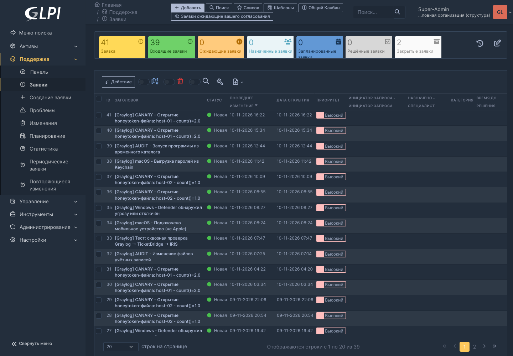

# TicketBridge

Мост «Graylog → GLPI + DFIR-IRIS» маршрутизирует алерты по приоритету:
High создаёт заявку GLPI со ссылками на разбор в HomeWiki, отчёт TrafficLens
и кнопкой блокировки IOC в BlockBoard, а также алерт в IRIS; Medium и Low
создают только алерт IRIS и не перегружают GLPI. Действия логируются обратно
в Graylog (GELF). Поддерживаются IRIS v2 (`POST /alerts/add`) и v3
(`POST /api/v2/alerts`), включая разные форматы ответа. Для передачи в IRIS
нужны `TB_IRIS_URL` и `TB_IRIS_KEY`; без них мост продолжает обрабатывать GLPI.

```
Graylog (HTTP notification) --POST /hook?key=...--> TicketBridge --REST--> GLPI Ticket
                                                             \--REST--> DFIR-IRIS Alert
```

## Скриншоты



## Корреляция инцидентов

Повторный алерт того же хоста (ключ: `fields.host` / `source` /
`event.key`) в течение окна `TB_CORR_WINDOW` (по умолчанию 1800 с)
не создаёт новый тикет, а дописывается **followup**'ом в уже открытый
— один инцидент вместо серии дублей. Закрытый тикет или истёкшее окно —
новый тикет. Состояние — в SQLite `state.db` рядом с приложением.

## Установка (сервер)

```bash
mkdir -p ~/ticketbridge && cp app.py ~/ticketbridge/
cp ticketbridge.env ~/ticketbridge/   # заполнить токены GLPI
cp systemd/ticketbridge.service ~/.config/systemd/user/
systemctl --user daemon-reload && systemctl --user enable --now ticketbridge
```

## Настройка DFIR-IRIS

- IRIS v2.4.x: `TB_IRIS_API_PATH=/alerts/add` (значение по умолчанию в коде).
- IRIS v3: `TB_IRIS_API_PATH=/api/v2/alerts`.

В нашей лаборатории с 11.11.2026 используется IRIS v3.0.0-beta.23 и
`TB_IRIS_API_PATH=/api/v2/alerts`; пример `ticketbridge.env.example` соответствует
этой конфигурации.

Путь должен начинаться с `/` и относиться к хосту из `TB_IRIS_URL`. API-ключ
передаётся как `Authorization: Bearer <TB_IRIS_KEY>`. Для v3 проверено создание
алерта с HTTP 201 и чтение прямого JSON-объекта без обёртки `status: success`.

### Source Link → Graylog Replay Search

Поле **Source Link** в новых алертах IRIS ведёт на повторный поиск конкретного
события Graylog: `<TB_GRAYLOG_URL>/alerts/<event.id>/replay-search`. Маршрут
соответствует Graylog 7.2.1 и использует `id` из HTTP-уведомления, поэтому
дополнительные запросы к API не нужны. Если у нестандартного события нет `id`,
используется резервная ссылка `<TB_GRAYLOG_URL>/alerts`.

Публичный адрес задаётся переменной `TB_GRAYLOG_URL` (по умолчанию
`https://graylog.apps.monitoring.test`). Уже созданные алерты IRIS не изменяются
автоматически: новая ссылка появляется у событий, принятых после обновления.

### Приоритеты и взятие в работу

Сопоставление приоритетов: Graylog 3 → IRIS **High** (5), 2 → **Medium** (1),
1 → **Low** (4). В GLPI попадает только High; для него urgency равна 5.
Аналитик может изменить приоритет в карточке: **алерт → Edit → Severity → Save**.

В лаборатории добавлен overlay `deploy/iris/alerts.py` для IRIS v3. Он отправляет
`alert_created` API caller'у при создании нового неназначенного алерта; через
TicketBridge это administrator. Если алерт создан уже назначенным, используется
только штатное `alert_assigned`. Дополнительно overlay отправляет `alert_assigned`,
когда владелец впервые становится текущим пользователем или меняется на него:
штатное поведение не сообщает пользователю о его собственных действиях. Повторное
редактирование Severity, описания и других полей своего алерта нового письма о
назначении не создаёт. Для работы нужны настроенный SMTP, адрес пользователя и
включённые email-уведомления в его профиле.

Файл подключается только к сервису `app`, не к `worker`:

```yaml
- ./custom/business/alerts.py:/iriswebapp/app/business/alerts.py:ro,z
```

После копирования файла в `custom/business/alerts.py` выполнить
`podman-compose up -d app`. При обновлении версии IRIS overlay нужно сверить
с новым `app/business/alerts.py`, а не переносить вслепую.

### Обогащение алертов активами (HostDeck)

TicketBridge подтягивает в каждый алерт IRIS затронутые **активы** и **IOC**:

- Поля события `srcip`/`dstip`/`agent_ip`/`source`/`host`/`user` и др.
  сопоставляются с инвентарём **HostDeck** (экспорт
  `/api/export/hosts.csv?key=ip|name`).
- Известные адреса и имена становятся активами алерта с типом по данным
  HostDeck: Linux Server/Computer, Mac, Windows, Router (Keenetic), DC.
- Учётные записи из полей `user`/`acct`/`username` — активы **Account**.
- Неизвестные HostDeck IP-адреса попадают в алерт как IOC `ip-any`.
- При эскалации алерта в кейс активы и IOC переносятся автоматически и
  участвуют в графе связей кейса.

Настройка в `ticketbridge.env`:

```ini
TB_HOSTDECK_URL=http://127.0.0.1:8080
TB_HOSTDECK_TOKEN=<HOSTDECK_EXPORT_TOKEN>
TB_HOSTDECK_TTL=300          # кеш инвентаря, секунд
```

Пустой `TB_HOSTDECK_TOKEN` отключает обогащение. Инвентарь кешируется, при
недоступности HostDeck используется последний кеш — доставка алертов не
ломается (предупреждение уходит в Graylog как `tb_event=hostdeck_error`).
Сопоставление типов активов задано в `app.py` (`_asset_type_for`) и легко
правится под свой инвентарь.

## Подготовка GLPI

1. Настройка → Общие → API: включить REST API.
2. Там же добавить API-клиента → получить **app_token**.
3. Администрирование → Пользователи → служебный пользователь →
   ключи удалённого доступа → **user_token**.

Оба токена — в `ticketbridge.env` (`TB_GLPI_APP_TOKEN`, `TB_GLPI_USER_TOKEN`).

## Автозакрытие (цикл MTTR)

- **Восстановление**: событие вида `agent_recovered` / «вернулся» по тому же
  хосту закрывает открытый тикет с комментарием (правило Graylog
  «HOMEREPO - Агент вернулся на связь» шлёт только вебхук, без письма).
- **TTL**: раз в 30 минут фоновый sweeper закрывает инциденты, по которым
  нет новых алертов дольше `TB_CLOSE_AFTER` (по умолчанию 24 ч) — с
  комментарием «Автозакрытие: тишина».
- События `tb_event=closed_recovery` / `autoclose` уходят в Graylog, так что
  Lab Score видит честное время жизни тикетов (MTTR).

## Интеграция Zabbix

Для событий Zabbix мост использует `alert_source_ref=zabbix:<event_id>`,
сохраняет важность источника и добавляет ссылки на событие Zabbix, Replay Search
в Graylog и рунбук HomeWiki. Заголовок строится из `zabbix_trigger_name` и имени
хоста. Соответствие важности: Zabbix 0–2 → IRIS Low, 3 → Medium, 4–5 → High;
обычные Graylog-алерты используют прежнее соответствие, описанное выше.

После `RESOLVED` мост закрывает связанный алерт IRIS статусом `6` и добавляет
комментарий с event ID, длительностью и ссылками. Ошибка комментария логируется
как `iris_comment_error`, но не отменяет успешное закрытие. Дедупликация по
event ID сохраняется в SQLite и не создаёт новый алерт при повторной доставке.

В агрегационных правилах Graylog передаваемые поля должны быть одновременно в
`group_by` и `field_spec`. Безопасное обновление обоих Zabbix-правил:

```bash
python3 tools/sync_zabbix_graylog_fields.py          # dry-run
python3 tools/sync_zabbix_graylog_fields.py --apply  # backup, update, verify
```

В `tools/` также находятся:

- `zabbix_suite.py` — сервисная модель, SLA, карта, окна обслуживания и отчёты
  по шуму/флаппингу/MTTA/MTTR;
- `soc_watchdog.py` — проверка Zabbix, Graylog, IRIS и TicketBridge с trapper-
  метриками и authenticated GELF fallback при недоступности Zabbix;
- `soc-watchdog.service`, `soc-watchdog.timer`, `zabbix-analytics.service`,
  `zabbix-analytics.timer` — пользовательские systemd-юниты;
- `test_zabbix_suite_e2e.py` — двухфазный сквозной тест PROBLEM/RESOLVED с
  восстановлением важности триггера и очисткой тестовых объектов.

Секреты передаются через окружение; на сервере таймеры читают защищённый
`~/zabbix-suite/watchdog.env`. Подробная схема и руководство:
`https://homewiki.apps.monitoring.test/rules/art-zabbix-graylog-iris`.

## Graylog

System → Alerts → Notifications → HTTP Notification:
URL `http://127.0.0.1:8099/hook?key=<TB_KEY>`. Одно уведомление
`GLPI Ticket (TicketBridge)` привязывается ко **всем активным правилам**,
а мост сам разделяет маршруты GLPI и IRIS по приоритету.

Для безопасной массовой привязки используется `tools/sync_graylog_iris.py`:

```bash
export GRAYLOG_URL='https://graylog.apps.monitoring.test'
export GRAYLOG_TOKEN='<access-token>'
python3 tools/sync_graylog_iris.py             # только dry-run
python3 tools/sync_graylog_iris.py --apply     # backup, обновление, проверка
```

Скрипт не меняет отключённые правила и правила с `alert=false`, перед записью
повторно читает каждое определение и сохраняет JSON-копии с правами `0600` в
`~/ticketbridge/backups/iris-all-alerts-<timestamp>/`. Для пилота есть
`--only-id <event-definition-id>`. На 11.11.2026 проверена привязка 255/255
активных правил; сквозные тесты Low, Medium и High подтвердили создание алертов
IRIS, при этом GLPI-заявки для Low и Medium не создаются.

### Мгновенные письма Graylog и IRIS

По выбору владельца лаборатории мгновенные письма отправляют **оба канала**:
Graylog и IRIS. Поэтому об одном событии могут прийти два письма — это ожидаемое
поведение, а не ошибка маршрутизации. Ежедневные дайджесты работают отдельно.

11.11.2026 мгновенные email-привязки Graylog восстановлены у **252 активных
правил**. Все **255/255** webhook-привязок TicketBridge сохранены, уведомления
IRIS `alert_created` и `alert_assigned` не отключались. **Mail.ru Alert Daily
Digest** и **Mail.ru Daily Digest** также сохранены. Результат проверен через
API Graylog; это не заменяет проверку доставки конкретного письма в ящик.

Если позже понадобится оставить только IRIS как отправителя мгновенных писем,
используется `tools/sync_graylog_mail.py`:

```bash
python3 tools/sync_graylog_mail.py             # dry-run: показать дубли
python3 tools/sync_graylog_mail.py --apply     # backup, обновление, проверка
python3 tools/sync_graylog_mail.py --only-id <event-definition-id> --apply
```

Скрипт удаляет только привязки мгновенных `email-notification-v1` у активных
правил, уже подключённых к TicketBridge. Он сохраняет webhook TicketBridge,
отключённые правила и правила с `alert=false`, уведомления с `digest` в названии
и все прочие привязки. JSON-копии до и после сохраняются с правами `0600` в
`~/ticketbridge/backups/iris-mail-primary-<timestamp>/`.

Обратное восстановление выполняется из этих частных копий скриптом
`tools/restore_graylog_mail.py`. Сначала обязателен dry-run, затем `--apply`:

```bash
python3 tools/restore_graylog_mail.py \
  --backup ~/ticketbridge/backups/iris-mail-primary-20261111T112018Z \
  --backup ~/ticketbridge/backups/iris-mail-primary-20261111T112037Z
# Повторить ту же команду с --apply после проверки списка.
```

Restore объединяет сохранённые привязки, добавляет только отсутствующие и перед
каждым PUT повторно читает текущее определение, поэтому позднейшие изменения и
другие уведомления не затираются. Свежая копия создаётся в
`~/ticketbridge/backups/graylog-mail-restored-<timestamp>/`; фактическая копия
восстановления 11.11.2026 — `graylog-mail-restored-20261111T132748Z`.

## Проверка

```bash
curl -X POST 'http://127.0.0.1:8099/hook?key=<TB_KEY>' \
  -H 'Content-Type: application/json' \
  -d '{"event":{"message":"Тест","timestamp":"...","priority":3,"event_definition_id":"...","fields":{}}}'
```

События в Graylog: `tool:ticketbridge`.
